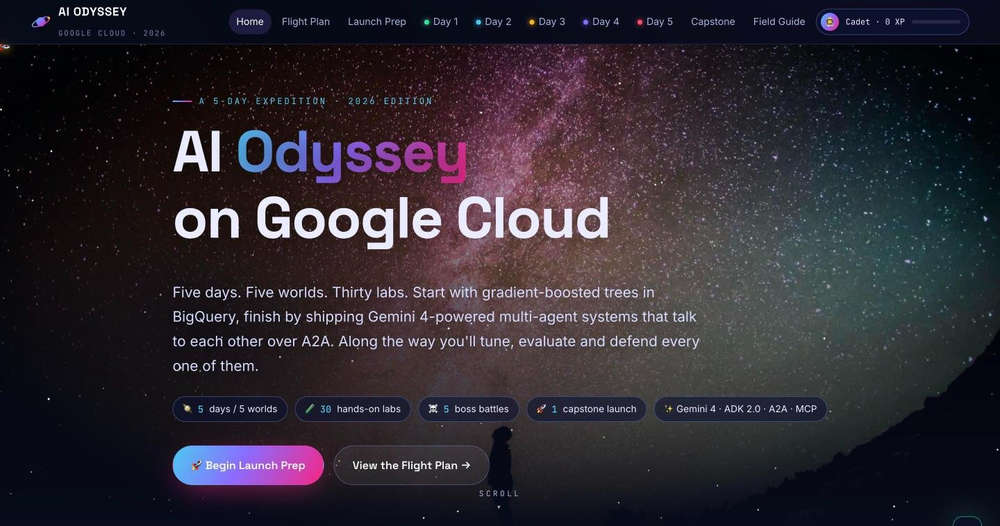
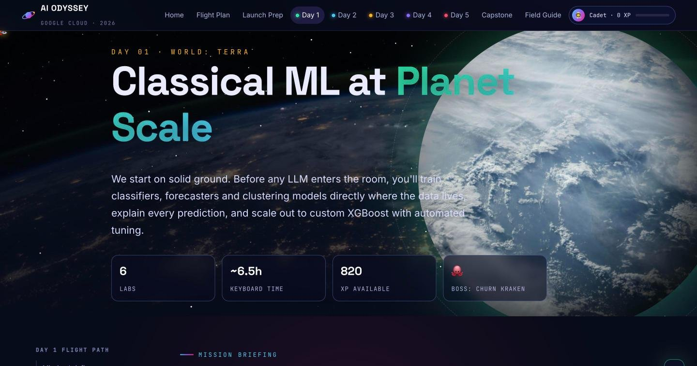

# 🚀 AI Odyssey: Advanced AI on Google Cloud (2026 Edition)



A 5-day, hands-on course website covering classical ML through frontier generative AI and agents on Google Cloud. It runs as a static site on GitHub Pages.

| Day | World | Theme |
|-----|-------|-------|
| 0 | Launch Prep | Project, APIs, budgets, IAM, SDKs, first Gemini call |
| 1 | Terra | Classical ML at planet scale: BigQuery ML, TimesFM, bigframes, XGBoost + HP tuning |
| 2 | Luna | MLOps: Pipelines, Experiments, Registry, Endpoints, Feature Store, Monitoring, CI/CD |
| 3 | Jupiter | Gemini 4 & multimodal gen AI: structured output, grounding, tools, image/video, AI in BigQuery |
| 4 | Saturn | RAG & agents: embeddings, vector search, RAG Engine, ADK 2.0, MCP, A2A, Agent Runtime |
| 5 | Mars | Tuning, Gemma 4 on Cloud Run GPUs, evaluation, Model Armor, cost & scale, plus the capstone |

The site has 30 labs, 25 side quests, 5 boss battles, and a capstone.

What makes it engaging:
- **Predict before you run.** Learners commit to a guess, then reveal the answer.
- **"What you'll see" windows.** Each one shows a representative output so learners know what success looks like. Day 4 also includes **real screenshots** of the ADK 2.15 Dev UI.
- **Side quests** such as Leak Hunter, Prompt Golf and Unicode Smuggler earn bonus XP.
- **Mission clocks** time each lab and keep a personal best.
- **Boss battles** have live HP bars, plus XP, ranks (Cadet → Admiral), badges and confetti.
- **A continuous story.** One dataset (`thelook_ecommerce`) threads through all five days, with "Previously on…" recaps and next-mission teasers.

Progress is saved in each learner's browser (localStorage); there's no backend.



## Run locally
```bash
python3 -m http.server 8000
# open http://localhost:8000
```

## Publish on GitHub Pages
1. Push this folder to a GitHub repo.
2. Go to **Settings → Pages → Build and deployment → Deploy from a branch**, then pick `main` / `/ (root)`.
3. The site appears at `https://<user>.github.io/<repo>/`.

## Structure
```
index.html        landing page
syllabus.html     the full course plan ("Flight Plan")
setup.html        Lab 0: environment setup
day1-5.html       daily modules, labs, boss battles, quizzes
capstone.html     capstone brief and rubric
field-guide.html  cheat sheets, model IDs, glossary, cleanup
assets/css, assets/js, assets/img
```

## Keeping it current
Model IDs and product names were verified in November 2026 against Google Cloud's model-versions page. Re-verify before each cohort; the Field Guide lists everything in one place.

Photography is from Unsplash (Unsplash License). Diagrams are original. This course is independent and not affiliated with Google.
